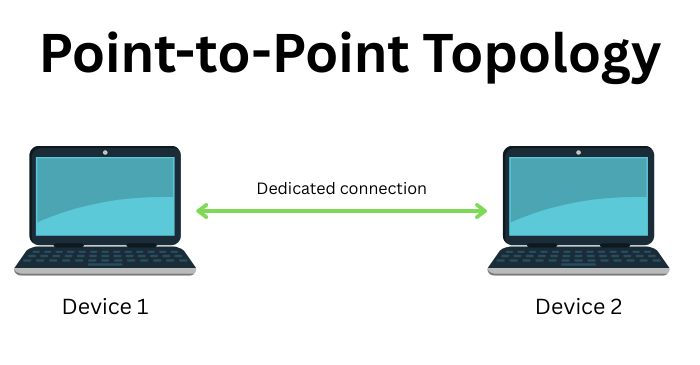
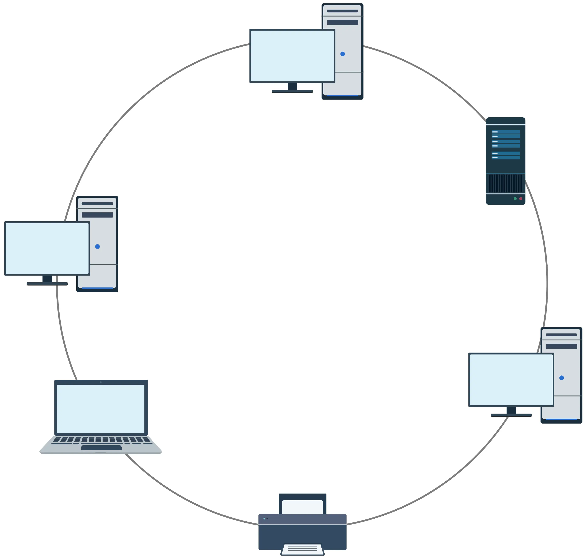
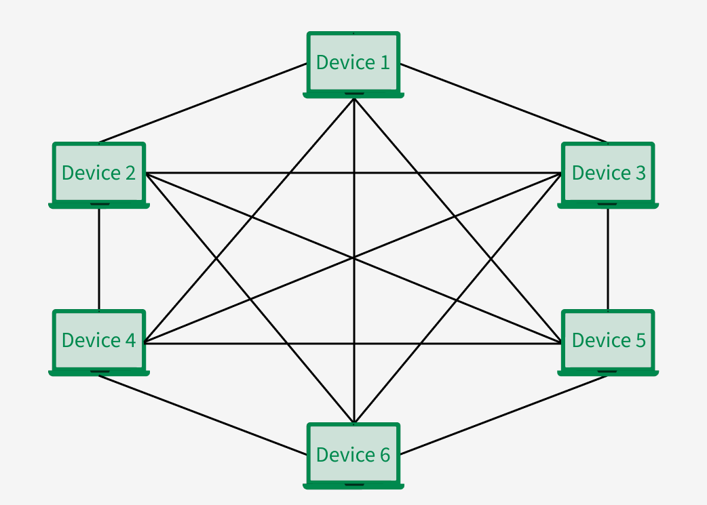
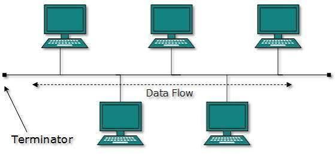
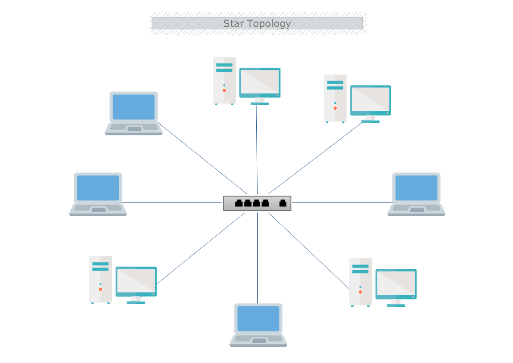

# 02 - Network Topologies & Network Types

### 1. تطور الشهادات ومسارات سيسكو (Cisco Certification Paths)
شهادات سيسكو مصممة على شكل هرم وظيفي يتدرج من الأساسيات حتى الخبراء:
- **المستويات الأساسية:**
  * **Associate (CCNA 200-301):** مستوى المبتدئ والملتحق بالمجال، يعتبر الأساس لكل التخصصات القادمة.
  * **Professional (CCNP):** مستوى الاحتراف، يتطلب اجتياز امتحانين (امتحان عام Core + امتحان تخصصي Concentration).
  * **Expert (CCIE):** مستوى الخبير، ويكون امتحانه عملي (Lab) بحت في مراكز سيسكو المعتمدة دولياً، وهو الذي يرفع من راتب المهندس بشكل فلكي.
- **التخصصات الستة (Tracks):** 
  (Enterprise, Service Provider, Data Center & Cloud, Security, Automation, Collaboration).

---

### 2. الشركات المصنعة لأجهزة الشبكات (Network Vendors)
بالرغم من تركيز الكورس على أجهزة Cisco بصفتها الرائدة، إلا أن هناك منافسين أقوياء في السوق يجب أن تعرفهم:
- **منافسي الراوترات والسويتشات:** `Juniper` و `Aruba (HP)`.
- **شركات الحماية (Security/Firewalls):** `Fortinet (FortiGate)`، `Palo Alto`، و `Sophos`.
- **شركات التخزين ومراكز البيانات:** `Dell EMC`.
- **💡 ملحوظة هامة:** الأساس العلمي (Concepts) ثابت بين جميع هذه الشركات، الاختلاف الوحيد يكون في واجهة الاستخدام وطريقة كتابة الأوامر (Syntax).

---

### 3. طرق التوصيل في الشبكات (Network Topologies)
مصطلح التوبولوجي (`Topology`) يعني الطريقة التي يتم بها توصيل الأجهزة في الشبكة، وقد تطورت عبر الزمن كالتالي:

<strong>1. Point-to-Point Topology:</strong>

أول توصيلة في التاريخ (1950)، عبارة عن كابل يربط جهازين فقط ببعضهما.

  

 

***

 

<strong>2. Ring Topology:</strong>

الأجهزة متصلة ببعضها في شكل حلقة.
* **العيوب:** يوجد بها "لف ودوران"؛ البيانات تمر على كل الأجهزة حتى تصل لهدفها، وإذا تعطل جهاز انقطعت الشبكة.

  

 

***

 

<strong>3. Mesh Topology:</strong>

كل جهاز متصل بكابل مباشر لكل جهاز آخر في الشبكة.
* **العيوب:** لا يوجد بها لف ودوران، لكن تكلفتها عالية جداً وتحتاج لعدد ضخم من كروت الشبكة (NICs) والكابلات.

  

 

***

 

<strong>4. Bus Topology:</strong>

كابل رئيسي (Backbone) تتصل به كل الأجهزة.
* **العيوب:** غير آمنة (الكل يرى البيانات المارة)، وتحدث فيها مشكلة تصادم البيانات (`Collision`) إذا أرسل جهازان في نفس اللحظة.

  

 

***

 

<strong>5. Star Topology (المستخدمة حالياً):</strong>

يتم ربط كل الأجهزة الطرفية (`End Devices`) بجهاز وسيط في المنتصف (`Intermediate Device`) مثل الـ `Switch`.
* **المميزات:** تنظم المرور بحرفنة بدون تصادم للبيانات، ووفرت في استهلاك الكابلات والكروت، وهي التوبولوجي التي فتحت الباب لظهور وتألق شركة سيسكو.

  

 

---

### 4. تصنيف الشبكات بناءً على المساحة (Network Types by Scope)
تُصنف شبكات البيانات (IP Networks) بناءً على الرقعة الجغرافية التي تغطيها إلى:

- **LAN (Local Area Network):** 
  
  هي شبكة داخل مساحة محدودة وتحت السيطرة الكاملة (ملكية خاصة)، مثل شبكة داخل مبنى واحد أو منزل أو فرع شركة.

- **WAN (Wide Area Network):** 
  
  عبارة عن مجموعة من الـ LANs المتباعدة جغرافياً، تربط بين محافظات أو دول أو قارات. ولإنشاء شبكة WAN، لا بد من الاستعانة بشركة اتصالات أو مزود خدمة (`Service Provider` مثل WE, Vodafone, Orange) لتوفير البنية التحتية مقابل اشتراك.

- **MAN (Metropolitan Area Network):** 
  
  شبكة تربط بين فروع داخل **نفس المحافظة أو المدينة** (مثال: ربط فرع للبنك في مدينة نصر بفرع آخر في الهرم).

- **CAN (Campus Area Network):** 
  
  مجمع مباني متعددة داخل سور واحد وتحت إدارة واحدة (مثل الحرم الجامعي).