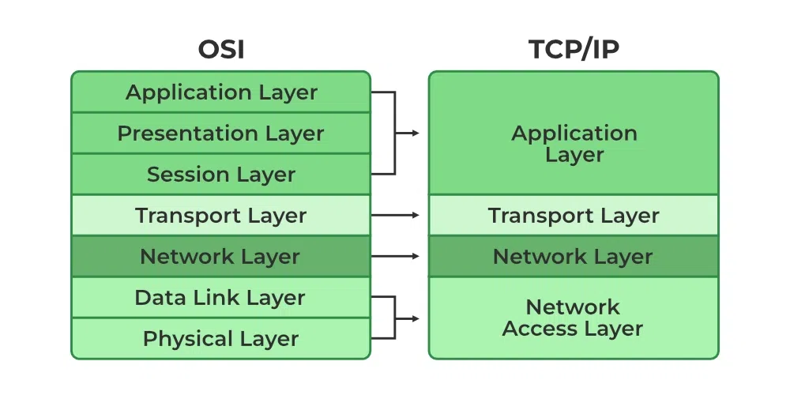
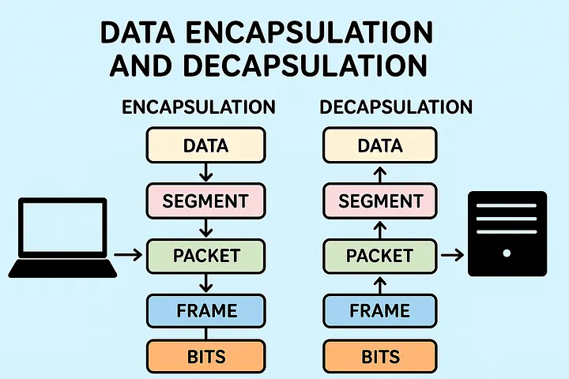
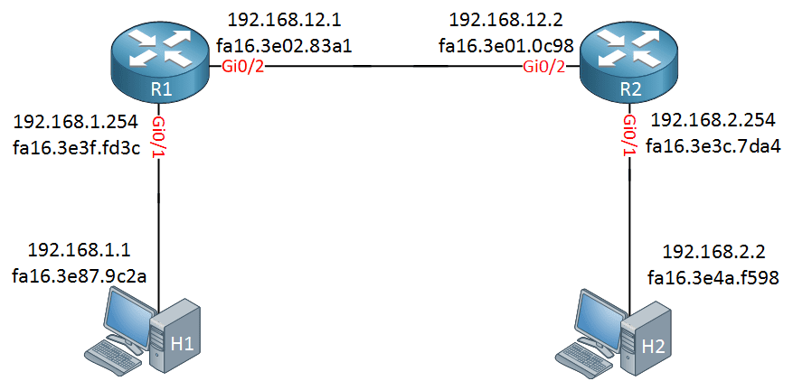

# 03 - Network Models (OSI vs TCP/IP)

### 1. مقدمة: كيف تتفاهم الأجهزة؟ (دستور الشبكات)
الكمبيوترات لا تفهم الحروف والصور والصوت البشري، بل تفهم الإشارات الكهربائية فقط.
- **التحويل لغة الآلة:** الموديل (دستور الشبكات) عبارة عن `Software` يقوم بتحويل بيانات البشر إلى لغة الوحايد والأصفار (Binary `0s & 1s`) استناداً إلى جداول عالمية مثل `ASCII Code` (مثال: الحرف يُترجم إلى `8 Bits` أي `1 Byte`).
- **التحويل لإشارات:** يقوم كارت الشبكة (`Hardware`) بتحويل هذه الأصفار والوحايد إلى نبضات كهربائية (مثال: `5 Volt` للواحد، و `0 Volt` للصفر) لتمشي في الكابلات بسرعة تقارب سرعة الإلكترون.
- **زمن التأخير (Target Delay):** لضمان جودة الشبكة وعدم حدوث تقطيع في الخدمات المباشرة (`Real-Time` مثل مكالمات الفيديو)، يجب ألا يتجاوز زمن وصول الإشارة من جهاز لآخر **`150 ms` (ملي ثانية)**.

---

### 2. تاريخ نماذج الشبكات (Evolution of Network Models)
- **DoD Model:** أول "دستور" شبكات صممه الجيش الأمريكي قديماً (`Department of Defense`) في الخمسينات لتبادل المعلومات سرياً بين أجهزته.
- **OSI Model (Open Systems Interconnection):** 
  نموذج يتكون من **7 طبقات (Layers)**. كان يُستخدم قديماً للربط بين الأجهزة، ولكنه بعد عام 2000 أُحيل للتقاعد وأصبح نموذجاً مرجعياً (`Reference Model`) يُدرس فقط في الأكاديميات لفهم تسلسل مهام الشبكة بالتفصيل، ولا تُبنى عليه الأجهزة الحديثة.
- **TCP/IP Model:** 
  هو النموذج التجاري (`Commercial Model`) المُطور من الـ `DoD`، وهو المُستخدم إجبارياً ورسمياً في كل أجهزة العالم حالياً. يتكون من **4 طبقات**، حيث تم فيه دمج عدة طبقات من الـ OSI لتسريع وتبسيط عملية النقل.

 

  

 

---

### 3. طبقات الـ TCP/IP وتغليف البيانات (Data Encapsulation)
عملية التغليف (`Encapsulation`) تعني أن كل طبقة تمر عليها البيانات تُضيف "رأس/هيدر" (`Header`) خاص بها، وتُغير اسم وحدة القياس (`PDU - Protocol Data Unit`).

#### أ. طبقة التطبيقات (Application Layer)
- تدمج 3 طبقات من الـ OSI وهي: (Application, Presentation, Session).
- **الوظيفة:** تحويل البيانات من لغة البشر إلى وحايد وأصفار عبر تطبيقات معينة، مثل:
  * `HTTP` (للتصفح الآني).
  * `FTP` (لتحميل ورفع الملفات الضخمة).
  * وغيرها مثل WhatsApp, Zoom, Uber.
- **وحدة القياس (PDU):** يُطلق على البيانات في هذه المرحلة اسم **`Data`**.

#### ب. طبقة النقل (Transport Layer)
- **الوظيفة الأساسية:** تختار بين بروتوكولين لإدارة نقل البيانات:
  * **`TCP` (للدقة):** يضمن وصول البيانات كاملة بلا أخطاء (للملفات، النصوص، الإيميلات).
  * **`UDP` (للإنجاز والسرعة):** يركز على السرعة وعدم التأخير حتى لو سقطت بعض البيانات (للبث المباشر، الألعاب، المكالمات).
- **المهام الثلاثة المشتركة (للـ TCP والـ UDP):**
  1. **التقطيع (Segmentation):** تقطيع البيانات الكبيرة إلى أجزاء لتسريع النقل، بحيث لا يتجاوز الجزء الصافي من الداتا **`1460 Bytes`**.
  2. **الترقيم (Sequencing):** إعطاء كل جزء رقم تسلسلي ورقم جلسة (`Session Number`) لمعرفة ترتيبه (مثال: `1/1` أو `1/4`)، والجزء الأخير يأخذ علامة **`FIN`** (أي Finish) ليعلم المستلم أن الملف انتهى.
  3. **اكتشاف الأخطاء (Error Detection):** عمل صورة مصغرة مضغوطة بحجم `2 Bytes` تُسمى **`CRC`**، وإرفاقها ليقوم المستلم بمقارنتها واكتشاف أي تلاعب أو خطأ حدث للبيانات في الطريق.
- **وحدة القياس (PDU):** يُضاف هيدر بحجم أقصى `20 Bytes` للداتا المقطعة (`1460 Bytes`)، ليصبح الحجم الإجمالي `1480 Bytes` ويُطلق عليها اسم **`Segment`**.

#### ج. طبقة الإنترنت (Internet / Network Layer)
- **البروتوكول المستخدم:** الـ `IP` كـ سوفت وير.
- **الوظيفة:** التوجيه العناوين المنطقية (`Logical Addresses`).
- يتم هنا إرفاق **`Source IP`** (عنوان المُرسل) و **`Destination IP`** (عنوان المُستلم النهائي). *(الآي بي يتغير بتغير الشبكة المتصل بها الجهاز).*
- **وحدة القياس (PDU):** يُضاف هيدر الـ IP (بحجم `20 Bytes`) للـ `Segment`، ليُصبح الحجم **`1500 Bytes`** ويُطلق عليها اسم **`Packet`**.
- **الـ MTU (Maximum Transmission Unit):** هو أقصى حجم مسموح للـ `Packet` وهو `1500 Bytes` (الطرد المُراد إيصاله للنهاية كما هو).

#### د. طبقة الوصول للشبكة (Network Access Layer)
- تدمج طبقتي (Data Link & Physical) من الـ OSI.
- **وظيفة الـ Data Link:**
  * إضافة العناوين الفيزيائية (**`MAC Address`**) لضمان التوجيه خطوة بخطوة (`Hop-by-Hop`). *(الماك أدرس ثابت لا يتغير وهو مثل اسم الجهاز من المصنع).*
  * يُضاف رأس (`Header`) به الماكات، وذيل (`Trailer`) به `CRC` جديد من `4 Bytes` يصور الطرد بالكامل.
  * **وحدة القياس (PDU):** تُصبح البيانات مُبروزة وتُسمى **`Frame`** بحجم أقصى **`1518 Bytes`**.
- **وظيفة الـ Physical:**
  * يقوم الكارت (`NIC`) بتحويل الـ `Frame` لنبضات كهربائية لتمشي في الكابلات.
  * **تطور السرعات:**
    * **Ethernet (سلكي):** بدأ بـ `10 Mbps`، ثم `Fast Ethernet (100 Mbps)`، ثم `Gigabit (1000 Mbps)`، وحالياً في انتظار كارت الـ `Terabit (1 Trillion bps)`.
    * **Wi-Fi (لاسلكي):** (ابتكار العالم المصري د. حاتم زغلول)، تتطور أجياله وصولاً لـ `Wi-Fi 6` بسرعة `9.6 Gbps` والآن `Wi-Fi 7` بسرعة فلكية `56 Gbps`.

 

  

 

---

### 4. رحلة البيانات عبر الرواتر (Hop-by-Hop Concept)
- **القاعدة الذهبية:** الأجهزة الوسيطة (الرواتر) لا تلمس محتوى الـ `Packet` أبداً. (عناوين الـ IP الخاصة بالمصدر والوجهة النهائية تظل ثابتة طوال الرحلة).
- **كيف يوجه الراوتر؟**
  1. يستلم الراوتر الـ `Frame` من الكابل.
  2. يقوم بقص الرأس والذيل (De-encapsulation) ليتأكد من صحة الـ `CRC` ويقرأ الـ `IP` ليعرف الوجهة النهائية.
  3. يقوم بصنع `Frame` جديد كلياً (`Encapsulation`)، ويضع فيه `MAC` الخاص به كـ Source، والـ `MAC` الخاص بالراوتر القادم كـ Destination.
- **الخلاصة:** الـ `IP` ثابت للإيصال للوجهة النهائية، بينما الـ `MAC` يتغير مع كل خطوة (قفزة) ليُسلم الطرد للمحطة التالية.

 

  

 

---

### 5. جدول التلخيص والمقارنة (OSI Model vs TCP/IP)

<table border="1" cellpadding="8" cellspacing="0" width="100%">
  <thead>
    <tr bgcolor="#161b22">
      <th align="center"># (OSI)</th>
      <th align="center">اسم الطبقة (OSI)</th>
      <th align="center">الطبقة المقابلة في الـ TCP/IP</th>
      <th align="center">وحدة القياس (PDU)</th>
      <th align="center">البروتوكولات و الأجهزة</th>
      <th align="center">الوظيفة الأساسية</th>
    </tr>
  </thead>
  <tbody>
    <tr>
      <td align="center"><strong>7</strong></td>
      <td align="center">Application</td>
      <td align="center" rowspan="3"><strong>Application Layer</strong></td>
      <td align="center" rowspan="3"><strong>Data</strong></td>
      <td align="center" rowspan="3"><code>HTTP</code>, <code>FTP</code>, <code>DNS</code>, <code>SMTP</code></td>
      <td rowspan="3">توفير الواجهة للمستخدم، تشفير وضغط البيانات، وتحويلها من لغة البشر إلى بيانات خام للآلة.</td>
    </tr>
    <tr>
      <td align="center"><strong>6</strong></td>
      <td align="center">Presentation</td>
    </tr>
    <tr>
      <td align="center"><strong>5</strong></td>
      <td align="center">Session</td>
    </tr>
    <tr>
      <td align="center"><strong>4</strong></td>
      <td align="center">Transport</td>
      <td align="center"><strong>Transport Layer</strong></td>
      <td align="center"><strong>Segment</strong></td>
      <td align="center"><code>TCP</code>, <code>UDP</code></td>
      <td>تقطيع الداتا، الترقيم (Sequence)، واكتشاف الأخطاء (CRC). (تختار بين الدقة والإنجاز).</td>
    </tr>
    <tr>
      <td align="center"><strong>3</strong></td>
      <td align="center">Network</td>
      <td align="center"><strong>Internet Layer</strong></td>
      <td align="center"><strong>Packet</strong></td>
      <td align="center"><code>IP Protocol</code> <strong>(Routers)</strong></td>
      <td>التوجيه المنطقي عبر إضافة عناوين الـ Source IP والـ Destination IP للوجهة النهائية. (MTU = 1500).</td>
    </tr>
    <tr>
      <td align="center"><strong>2</strong></td>
      <td align="center">Data Link</td>
      <td align="center" rowspan="2"><strong>Network Access Layer</strong></td>
      <td align="center"><strong>Frame</strong></td>
      <td align="center"><code>MAC Address</code> <strong>(Switches / NIC)</strong></td>
      <td>التوجيه الفيزيائي خطوة بخطوة (Hop-by-Hop) بإضافة هيدر للماكات و CRC إضافي في الذيل.</td>
    </tr>
    <tr>
      <td align="center"><strong>1</strong></td>
      <td align="center">Physical</td>
      <td align="center"><strong>Bits</strong></td>
      <td align="center"><code>Ethernet / Wi-Fi</code> <strong>(Cables / Hubs)</strong></td>
      <td>تحويل الإطارات (Frames) إلى إشارات كهربائية أو موجات لاسلكية لنقلها عبر وسط الاتصال.</td>
    </tr>
  </tbody>
</table>

