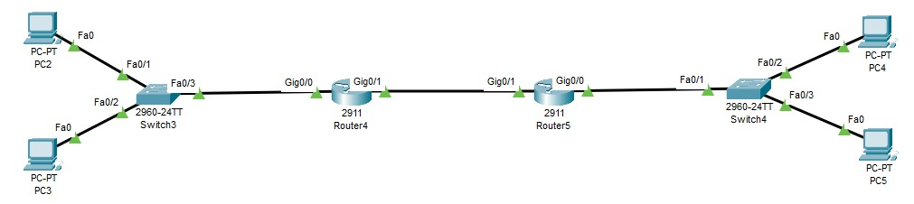

# 09 - Packet Tracer Lab 1: Initial Router Configuration

### 1. تخطيط الشبكة (Topology Design)
في هذا اللاب، قمنا ببناء شبكة مكونة من فرعين (Headquarters و Branch)، وكل فرع يمتلك شبكة محلية (LAN) موصلة براوتر، ويرتبط الراوتران معاً بخط (WAN).

- **الأجهزة المستخدمة:** <code>2 Routers</code> (موديل 2911)، <code>2 Switches</code> (موديل 2960)، <code>2 PCs</code>.
- **الآيبيهات المستخدمة:**
  * **الفرع الأول (LAN 1):** شبكة <code>192.168.1.0 /24</code>.
  * **الفرع الثاني (LAN 2):** شبكة <code>192.168.2.0 /24</code>.
  * **نقطة الربط (WAN):** شبكة <code>2.2.2.0 /30</code> (استخدمنا ماسك 30 لأنه يوفر 4 آيبيهات فقط لتجنب الإهدار).

### 2. إعدادات الكمبيوتر (PC Configuration)
ندخل على جهاز الكمبيوتر في البرنامج، ثم <code>Desktop -> IP Configuration</code>:
- نكتب الـ IP بناءً على الفرع (مثال للفرع الأول: <code>192.168.1.2</code>).
- الـ Mask يُكتب بالنظام القديم: <code>255.255.255.0</code>.
- الـ <code>Default Gateway</code>: هو عنوان واجهة الراوتر الداخلي (مثال: <code>192.168.1.1</code>).

### 3. إعدادات الرواتر (Router CLI Configuration)
ندخل إلى واجهة سطر الأوامر للراوتر الأول ونطبق الآتي:

<table border="1" cellpadding="8" cellspacing="0" width="100%">
  <thead>
    <tr bgcolor="#161b22">
      <th align="center">الخطوة / الأمر</th>
      <th align="center">الشرح</th>
    </tr>
  </thead>
  <tbody>
    <tr>
      <td><code>enable</code> <code>configure terminal</code></td>
      <td>الدخول لوضع الإعدادات الشاملة (ليفل 3).</td>
    </tr>
    <tr>
      <td><code>hostname HQ</code></td>
      <td>تغيير اسم الراوتر ليدل على الفرع.</td>
    </tr>
    <tr>
      <td><code>enable secret cisco</code></td>
      <td>حماية الراوتر بكلمة سر مُشفرة.</td>
    </tr>
    <tr>
      <td><code>interface g0/0</code> <code>ip address 192.168.1.1 255.255.255.0</code> <code>no shutdown</code></td>
      <td>الدخول لكارت الـ LAN وإعطاؤه IP وتشغيله.</td>
    </tr>
    <tr>
      <td><code>exit</code></td>
      <td>الخروج من الكارت للدخول في الكارت الآخر.</td>
    </tr>
    <tr>
      <td><code>interface g0/1</code> <code>ip address 2.2.2.1 255.255.255.252</code> <code>no shutdown</code></td>
      <td>برمجة كارت الـ WAN (لن يضيء بالأخضر إلا بعد تفعيل الكارت المقابل في الراوتر الآخر).</td>
    </tr>
    <tr>
      <td><code>exit</code> <code>write</code></td>
      <td>لحفظ جميع الإعدادات حتى لا تضيع عند إعادة التشغيل.</td>
    </tr>
  </tbody>
</table>

### 4. اختبار الاتصال (Troubleshooting via Ping)
بعد تنفيذ نفس الخطوات على الفرع الآخر بآيبيهاته المختلفة، نفتح الـ <code>Command Prompt</code> لعمل <code>ping</code>:
- <code>ping 192.168.1.255</code>: بنج للبرودكاست للتأكد من أن جميع الأجهزة المتصلة بالسويتش حية.
- <code>ping 192.168.2.2</code>: بنج لجهاز في الفرع الآخر **سيفشل** لأن الراوتر لا يعرف مسار الفرع الآخر بعد (يُحل بالـ Routing لاحقاً).